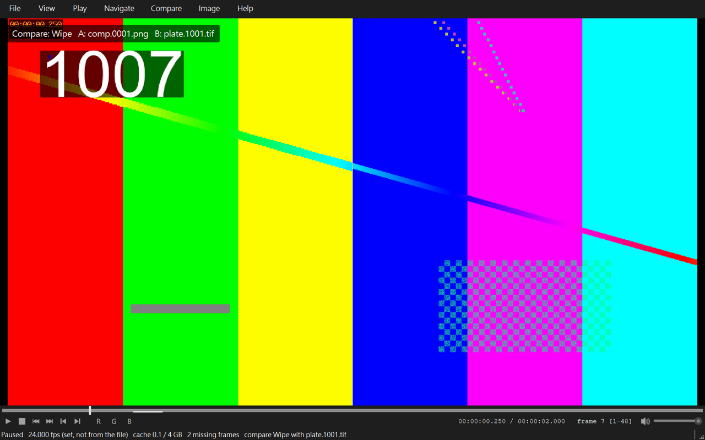

**Coreplay is a free, open-source player for movies and image sequences, made for film and VFX.** No sign-up, no ads, fully offline.

## Download

| System | File |
|---|---|
| Windows 10 / 11 | [Coreplay-Windows-Setup.exe](https://github.com/imCore-ai/coreplay/releases/download/v{{VERSION}}/Coreplay-Windows-Setup.exe) |
| macOS 12+, Apple silicon | [Coreplay-macOS-arm64.dmg](https://github.com/imCore-ai/coreplay/releases/download/v{{VERSION}}/Coreplay-macOS-arm64.dmg) |
| macOS 12+, Intel | [Coreplay-macOS-x86_64.dmg](https://github.com/imCore-ai/coreplay/releases/download/v{{VERSION}}/Coreplay-macOS-x86_64.dmg) |
| Linux (x86-64, any desktop) | [Coreplay-Linux-x86_64.AppImage](https://github.com/imCore-ai/coreplay/releases/download/v{{VERSION}}/Coreplay-Linux-x86_64.AppImage) |
| Ubuntu 22.04+ / Debian 12+ | [Coreplay-Linux-amd64.deb](https://github.com/imCore-ai/coreplay/releases/download/v{{VERSION}}/Coreplay-Linux-amd64.deb) — `sudo apt install ./Coreplay-Linux-amd64.deb` |

## New in {{VERSION}}

{{NEWS}}

## What Coreplay does

- **Plays everything:** every movie and audio format FFmpeg reads, with hardware decoding, plus EXR, DPX, Cineon, TIFF, PNG, HDR, PSD and JPEG 2000 sequences decoded on all CPU cores into a RAM cache.
- **Finds the sequence for you:** open one frame (`shot.1001.exr`) and Coreplay finds the range and the missing frames.
- **The real frame rate:** an EXR that carries its frame rate plays at that exact rate, 23.976 included. When a file carries none, Coreplay tells you so.
- **Colour, managed:** OpenColorIO on the GPU, every camera log space, ACES views one click away, LUTs and camera presets on movies and sequences alike.
- **Compare A and B:** flip, wipe, side by side or difference, on one frame-locked timeline.
- **Grade while it plays** (Alt+G), then Save or Export with the grade baked in.
- **Export anything it plays:** ProRes, DNxHR, H.264 / H.265, AV1, EXR, DPX, TIFF, PNG, WAV, FLAC. Frame counts and rates stay exact.
- **MPC-HC keys**, with changes for frame work. Press **F1** for the full list.
- **17 languages.** On Windows, Coreplay updates itself and installs only updates signed by imCore.

Questions or ideas? Open a [Discussion](https://github.com/imCore-ai/coreplay/discussions). Found a bug? Open an [Issue](https://github.com/imCore-ai/coreplay/issues). If Coreplay is useful to you, a ★ on the repo helps other people find it.

Made by [imCore](https://imcore.ai), the team behind [Core Studio](https://imcore.ai/core-studio.html).

**Full changelog:** https://github.com/imCore-ai/coreplay/compare/v{{PREVIOUS}}...v{{VERSION}}
