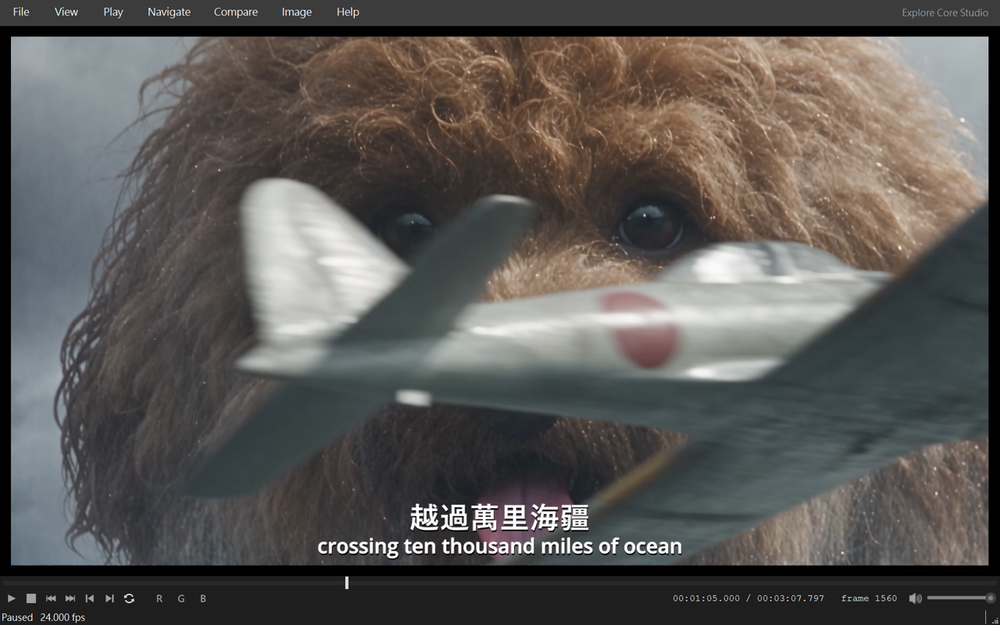
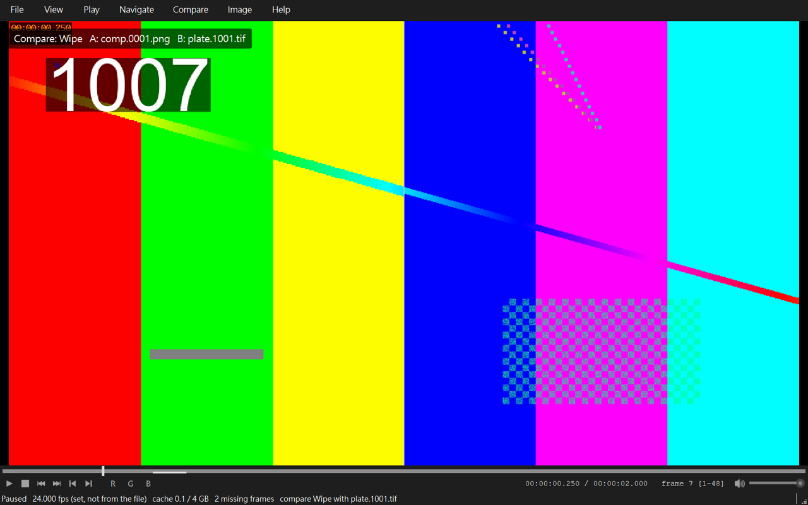

  

  <b>A fast media player for film and VFX review.</b> 
  Movies and image sequences (EXR, DPX, TIFF, PNG) in one window, with correct colour,
  exact frame rates and MPC-HC hotkeys. Windows and Linux. Fully offline.

  <a href="../../releases/latest"><b>Download</b></a> ·
  <a href="docs/USER_GUIDE.md">User guide</a> ·
  <a href="docs/DEVELOPMENT.md">Build from source</a>

## Download

| Platform | File | Notes |
|---|---|---|
| Windows 10 / 11 | `Coreplay-<version>-Setup.exe` | Per-user install, no admin rights. Updates itself (signed updates). |
| Linux: Rocky / Alma 9, Ubuntu 22.04+, Debian 12+, Fedora | `Coreplay-<version>-x86_64.AppImage` | One file, nothing to install: `chmod +x` it and run it. |
| Linux: Ubuntu 26.04 and newer | `coreplay_<version>_amd64.deb` | `sudo apt install ./coreplay_<version>_amd64.deb` |

All files are on the [Releases](../../releases/latest) page.

## Why Coreplay

- **One player for movies and frames.** Every format FFmpeg reads (MOV, MP4, MKV, MXF;
  ProRes, DNxHR, H.264, H.265, AV1, VP9), and image sequences: open any one frame and
  Coreplay finds the whole sequence, its range and its missing frames.
- **It never drops a frame.** Sequences decode on all CPU cores into a RAM cache.
  Playback shows every frame in order, at the exact rational rate in the file
  (for example 24000/1001), and says so when the file has no rate.
- **Correct colour.** OpenColorIO on the GPU, with every camera log space built in.
  LUT presets for ARRI LogC3/C4, S-Log3, RED Log3G10, Canon Log, V-Log, D-Log, Apple Log
  and ACES to sRGB, Rec.709 or Rec.2020, or load any `.cube` / `.3dl` / `.clf` file.
- **Review tools.** A/B compare (flip, wipe, side by side, difference) on one
  frame-locked timeline, zoom to 1:1, R / G / B channels, and an info overlay with the
  EXR header.
- **Live colour grading** (Alt+G) while the clip plays. Save, Save As and Export bake
  the grade into new files.
- **Export to delivery formats.** ProRes, DNxHR, H.264 / H.265 (also on NVIDIA GPUs),
  AV1, EXR, DPX, TIFF and PNG sequences, with exact frame counts and frame rates.
- **Fast.** The window paints in about 0.25 s; the first movie is ready in about 0.5 s.
- **Keyboard first.** The MPC-HC key table, changed for frame work. Press **F1** for the
  full list; change any key in `hotkeys.json`.

## Fully offline

Playback, grading and export need no network. The only network use is the update
check on Windows, which you can turn off in Settings. A Windows update installs only
when its signature and SHA-256 match.

## Build from source

See [docs/DEVELOPMENT.md](docs/DEVELOPMENT.md): Windows (Visual Studio + Qt + vcpkg),
Linux .deb and AppImage (Docker), and the end-to-end tests.

## Licence

The Coreplay source code is licensed under the [Apache License 2.0](LICENSE).

The ready-made downloads on the Releases page also contain third-party libraries under
their own licences: libmpv and FFmpeg (GPL builds, with x264 and x265), Qt (LGPL),
OpenImageIO, OpenEXR and OpenColorIO (BSD / Apache). Because of the GPL parts, the
downloads as a whole are distributed under the GNU General Public License v3.0. To make a
build without GPL parts, build Coreplay against LGPL builds of libmpv and FFmpeg
(see [docs/DEVELOPMENT.md](docs/DEVELOPMENT.md)).
