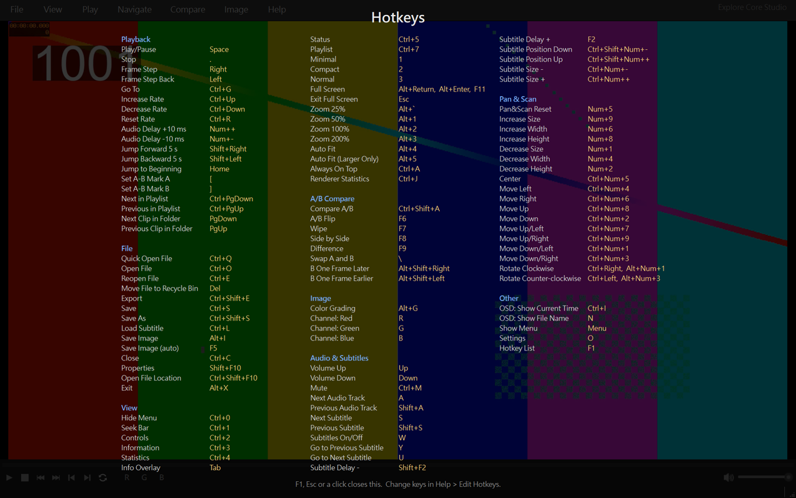

  

<h3 align="center">Every frame. Exactly as it is.</h3>

  A small, fast player for movies and image sequences, made for people who work on films. 
  <b>A pro tool, free forever. For everyone. No sign-up. No ads.</b>

  
  
  

  <b>Download:</b>
  <a href="https://github.com/imCore-ai/coreplay/releases/latest/download/Coreplay-Windows-Setup.exe">Windows</a> ·
  <a href="https://github.com/imCore-ai/coreplay/releases/latest/download/Coreplay-macOS-arm64.dmg">macOS</a> ·
  <a href="https://github.com/imCore-ai/coreplay/releases/latest/download/Coreplay-Linux-x86_64.AppImage">Linux AppImage</a> ·
  <a href="https://github.com/imCore-ai/coreplay/releases/latest/download/Coreplay-Linux-amd64.deb">Linux .deb</a>

Background: <i>God Being</i>, made with <a href="https://imcore.ai/core-studio.html">Core Studio</a>.

## Movies and frames, one window.

Open any movie, or any one frame of a sequence. Coreplay finds the rest of the shot, its
range and its missing frames, and plays it at its real frame rate, in the right colour.

| **0.25 s** | **0.5 s** | **0.2 s** | **0** |
|:---:|:---:|:---:|:---:|
| to paint the window | to the first movie frame | to the first EXR frame | skipped frames: playback waits, it never drops one |

## What it does

Everything you open in a day, in one fast player.

**01 · It plays everything.** Every movie and audio format FFmpeg reads, with hardware
decoding. And image sequences and single images, decoded on all CPU cores into a RAM cache.
 MOV · MP4 · MKV · MXF · ProRes · DNxHR · H.264 / H.265 · AV1 · VP9 · EXR · DPX · Cineon · TIFF · PNG · HDR · PSD · JPEG 2000

**02 · Sequences, found for you.** Open one frame. Coreplay finds the sequence
(`shot.1001.exr` → `shot.####.exr`), its range and its missing frames, and starts on the
frame you opened. The seek bar shows what is cached and what is missing.

**03 · The real frame rate.** An EXR that carries its frame rate plays at that exact rate,
23.976 included. When a file does not carry one, Coreplay tells you so on screen. It never
guesses quietly.

**04 · Colour, managed.** Image sequences go through OpenColorIO on the GPU, with every
camera log space. The default view is un-tone-mapped, as in Nuke and RV, so a PNG shows
exactly its own pixel values. The ACES views are one click away.

**05 · LUTs and camera presets.** Load any LUT OpenColorIO reads, or pick a preset from a
camera log to sRGB, Rec.709 or Rec.2020. On movies and sequences alike, on the GPU, with
hardware decoding still on.
 ARRI LogC3 / LogC4 · Sony S-Log3 · RED Log3G10 · Canon Log 2 / 3 · Panasonic V-Log · Blackmagic Gen5 · DaVinci Intermediate · Apple Log · DJI D-Log · ACEScg / ACEScct

**06 · Compare A and B.** Two clips on one frame-locked timeline: flip, wipe, side by side,
or a difference view that shows only what changed.

**07 · Grade while it plays.** Alt+G opens a translucent grading window over the picture:
brightness, contrast, saturation, hue, gamma, and a tint for shadows, midtones and
highlights. Save, Save As and Export bake the grade into the new file.

**08 · Export anything it plays.** Convert the clip, or just the A-B section, to a movie,
an image sequence or audio. Frame counts, frame rates and durations stay exact; a missing
frame is held, never dropped.
 ProRes 422 / 4444 · DNxHR · H.264 / H.265 · AV1 · OpenEXR half / float · DPX 10 / 16-bit · TIFF · PNG 16-bit · WAV / FLAC

**09 · A viewer for checking work.** Zoom with the wheel around the cursor, pan with the
middle button, snap to 1:1 or Fit. Show the red, green or blue channel alone. Rotate the
picture. Step frame by frame with the arrow keys.

**10 · Subtitles and playlists.** Drop a subtitle file on a movie, style it live, and burn
it in on export. Drop files and folders on the playlist; folders add their movies and
sequences.

## Your hands already know it.

The keys are MPC-HC's, with changes for frame work. Press **F1** to see them all over the
picture, and change any of them in one small file: Coreplay reloads it when you save.

| Key | Action | Key | Action |
|---|---|---|---|
| Space | Play / pause | ← → | One frame back / forward |
| Shift ← → | Jump 5 seconds | [ ] | Mark A / B |
| PgUp PgDn | Previous / next clip in the folder | R G B | Red, green or blue channel |
| Ctrl G | Go to a time or a frame | Ctrl Shift A | Compare A / B |
| Alt G | Colour grading | Ctrl Shift E | Export |
| Alt Enter | Full screen | F1 | Every hotkey |

## Free. For everyone.

A pro tool, free forever. No sign-up, no ads, and it works fully offline. On Windows it
checks for updates by itself, and installs only an update signed by imCore.

Get it from the **[latest release](https://github.com/imCore-ai/coreplay/releases/latest)**:

| System | File | Install |
|---|---|---|
| Windows 10 / 11 | `Coreplay-Windows-Setup.exe` | Run it. Installs for your user only, no admin prompt. |
| macOS (Apple silicon) | `Coreplay-macOS-arm64.dmg` | Drag Coreplay to Applications. The first time, right-click it and choose Open. |
| Linux (x86-64) | `Coreplay-Linux-x86_64.AppImage` | `chmod +x` it and run it. Ubuntu 22.04+ / Debian 12+: or `sudo apt install ./Coreplay-Linux-amd64.deb`. |

More: [user guide](docs/USER_GUIDE.md) · [build from source](docs/DEVELOPMENT.md)

---

Made by [imCore](https://imcore.ai), the team behind
[**Core Studio**](https://imcore.ai/core-studio.html), a complete film studio, anywhere you are.

The source code is licensed under the [Apache License 2.0](LICENSE). The ready-made
downloads also contain libmpv and FFmpeg (GPL builds, with x264 and x265), Qt (LGPL), and
OpenImageIO, OpenEXR and OpenColorIO (BSD / Apache); because of the GPL parts, the downloads
as a whole are distributed under the GNU GPL v3.0.
